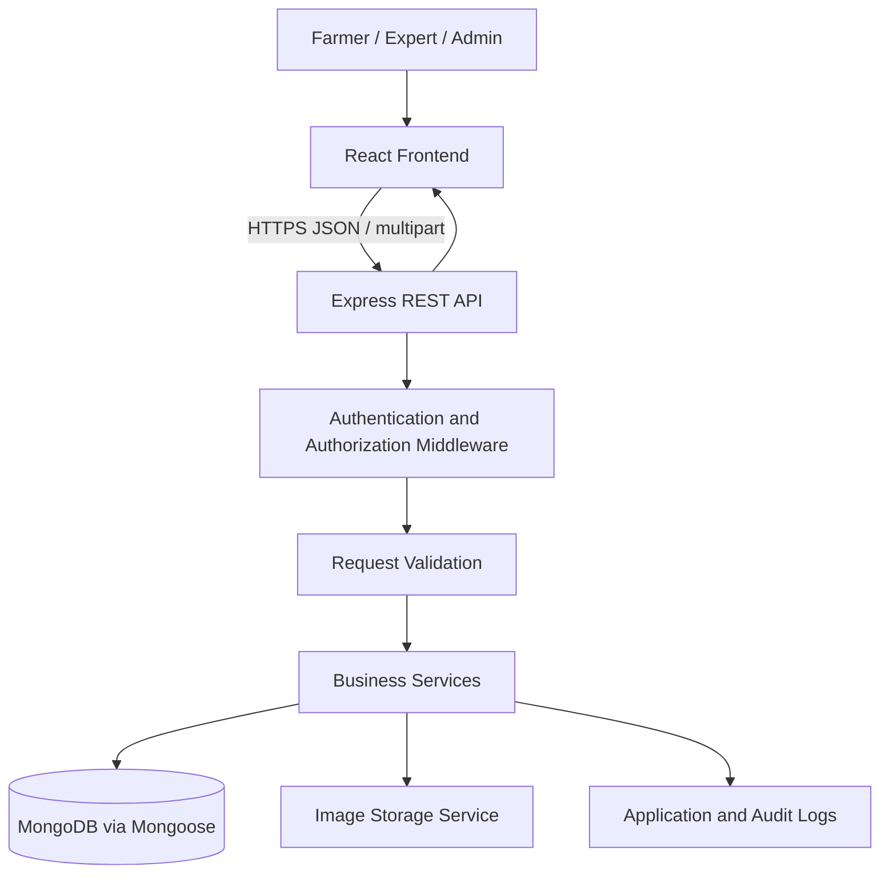

# Farm Problem Reporting & Expert Response System
## System Architecture Specification

**Version:** 1.0  
**Status:** Implementation specification  
**Related document:** `PRD.md`

## 1. Purpose

This document defines the recommended architecture for the Farm Problem Reporting & Expert Response System. The architecture must support the farmer, agriculture expert, and administrator workflows defined in the PRD while remaining practical for a 20-day academic project.

## 2. Architectural principles

- Keep the React client, Express API, database, and file storage responsibilities separate.
- Enforce authentication, authorization, validation, and workflow rules on the server.
- Keep business logic in service modules rather than duplicating it across controllers.
- Preserve report responses, status history, and assignment history.
- Use real persisted data for dashboards; do not hardcode production metrics.
- Build the smallest reliable version first; defer optional integrations.

## 3. High-level architecture



### Responsibilities

- **React frontend:** pages, forms, role-specific navigation, loading/error/empty states, charts, and API calls.
- **Express API:** REST endpoints, request parsing, validation, authentication, authorization, rate limits, and consistent error responses.
- **Service layer:** report lifecycle, assignment rules, response creation, similarity retrieval, notification creation, and statistics.
- **MongoDB/Mongoose:** persistent records, schema validation, references, and indexes.
- **Image storage:** store uploaded images and return stable references; never rely on ephemeral server-local files in production.
- **Audit logging:** record significant administrative actions and status/assignment changes.

## 4. Recommended repository structure

```text
farm-problem-system/
├── client/
│   ├── public/
│   └── src/
│       ├── assets/
│       ├── components/
│       ├── layouts/
│       ├── pages/
│       │   ├── public/
│       │   ├── auth/
│       │   ├── farmer/
│       │   ├── expert/
│       │   └── admin/
│       ├── services/
│       ├── hooks/
│       ├── context/
│       ├── utils/
│       ├── routes/
│       ├── App.jsx
│       └── main.jsx
├── server/
│   └── src/
│       ├── config/
│       ├── models/
│       ├── routes/
│       ├── controllers/
│       ├── services/
│       ├── middleware/
│       ├── validators/
│       ├── utils/
│       ├── jobs/
│       ├── app.js
│       └── server.js
├── docs/
│   ├── PRD.md
│   ├── design.md
│   ├── architecture.md
│   ├── database.md
│   ├── api.md
│   └── phases.md
├── .env.example
├── .gitignore
└── README.md
```

The client and server may have separate `package.json` files. Do not force a monorepo tool into this project unless there is a clear need.

## 5. Frontend architecture

### Core choices

- React.js with Vite.
- React Router for navigation.
- Tailwind CSS or the styling system already selected in `design.md`; choose one and use it consistently.
- Fetch or Axios as the single shared HTTP client.
- Chart.js for admin charts.
- A small authentication context/provider to expose the current user and role.

### Page groups

- Public: home, about/help, login, farmer registration.
- Farmer: dashboard, new report, my reports, report details/timeline, profile.
- Expert: dashboard, assigned cases, case details, similar cases, response/follow-up history, profile.
- Admin: dashboard, users, reports/assignment queue, crops, categories, statistics/settings.

### Frontend rules

1. Keep reusable components in `components/`; keep page-level composition in `pages/`.
2. Use route guards for user experience, but never treat them as the security boundary.
3. Show loading, empty, success, and error states for every major data operation.
4. Keep API calls in `services/`, not scattered throughout page components.
5. Do not store secrets in the frontend. Anything compiled into the client is public.
6. Refetch or invalidate relevant data after mutations so dashboards and lists reflect persisted changes.
7. Display status labels and explanatory text; do not communicate status by color alone.
8. Use accessible labels, keyboard focus states, and responsive layouts.

## 6. Backend architecture

Use a layered structure:

- **Routes:** map HTTP methods and paths to middleware/controllers.
- **Middleware:** authenticate the caller, enforce role/resource permissions, validate requests, apply rate limits, and handle errors.
- **Controllers:** translate HTTP requests into service calls and format responses.
- **Services:** implement business rules and database operations.
- **Models:** define Mongoose schemas, indexes, and model-level validation.
- **Utilities:** common errors, pagination, ID/report-number creation, and logging.

Suggested services:

- `authService`
- `userService`
- `problemService`
- `assignmentService`
- `responseService`
- `statusHistoryService`
- `similarCaseService`
- `cropService`
- `categoryService`
- `notificationService`
- `statisticsService`

Avoid putting all application logic in one large controller or one route file.

## 7. Authentication and authorization

- Use password hashing with bcrypt or Argon2; never store plaintext passwords.
- Sign short-lived JWT access tokens with a secret stored in environment variables.
- Choose and document a token-storage strategy. Prefer secure, HttpOnly cookies where the deployment and CSRF configuration support them; if bearer tokens are used, document storage and expiry behavior carefully.
- If cookies are used, configure `HttpOnly`, `Secure` in production, and appropriate `SameSite`; apply CSRF protection when needed.
- Validate JWT signature, expiry, and account status on protected requests.
- Invalidate/revoke sessions appropriately when an account is deactivated. A simple implementation can use a token-version or session-version field checked on each request.
- Enforce role permissions in middleware and resource ownership/assignment in service logic.
- Public registration may create farmer accounts only. Expert/admin accounts require an authorized process.
- Do not trust a `role`, `farmerId`, `expertId`, or `assignedExpertId` supplied by the client without server-side verification.

### Resource access rules

- Farmer: access own reports and their associated responses/follow-ups only.
- Expert: access currently assigned cases and cases they are permitted to review under project policy.
- Admin: system-wide access for permitted administrative operations.
- Every detail endpoint must verify resource access after loading the record; possession of an ID is not authorization.

## 8. Report lifecycle

Use one canonical status enum throughout the backend and frontend:

`SUBMITTED`, `ASSIGNED`, `UNDER_REVIEW`, `AWAITING_FARMER_INFORMATION`, `RESPONSE_PROVIDED`, `RESOLVED`, `REOPENED`.

Suggested transition policy:

| Current | Next | Actor / condition |
|---|---|---|
| SUBMITTED | ASSIGNED | Admin assigns an active expert |
| SUBMITTED | UNDER_REVIEW | Only if policy explicitly permits review before assignment |
| ASSIGNED | UNDER_REVIEW | Assigned expert |
| UNDER_REVIEW | AWAITING_FARMER_INFORMATION | Assigned expert requests information |
| AWAITING_FARMER_INFORMATION | UNDER_REVIEW | Farmer submits requested information |
| UNDER_REVIEW | RESPONSE_PROVIDED | Assigned expert saves a recommendation |
| RESPONSE_PROVIDED | RESOLVED | Assigned expert, with an appropriate resolution note |
| RESOLVED | REOPENED | Assigned expert or admin according to policy |
| REOPENED | UNDER_REVIEW | Assigned expert |

A farmer must not directly set a status. Create a status-history record for each successful transition, including previous/new status, actor, timestamp, and optional reason. Prefer a single service operation that validates the transition and writes both the problem update and history record consistently.

## 9. Image upload flow

1. The client sends a multipart request to the API.
2. The server validates size and actual file content/type, not just the extension.
3. The server generates a safe storage name and uploads to the configured storage provider.
4. The server stores the returned storage reference/URL with the report.
5. If report creation fails after upload, clean up the orphaned upload where practical.
6. Render images with an accessible alternative text and a fallback for failed loading.

Keep provider credentials on the server. Do not allow arbitrary remote URLs to be submitted as trusted uploaded images.

## 10. Similar solved problems

Implement a deterministic baseline first:

1. Query resolved cases with a usable expert response/resolution note.
2. Filter by matching crop and category IDs.
3. Tokenize normalized titles/descriptions and remove common stop words.
4. Compute a transparent keyword-overlap score for candidates.
5. Sort by score, then by resolution date.
6. Return only fields needed by the expert interface.
7. Exclude the current report and avoid exposing unnecessary farmer contact details.

A proposed score may combine crop/category matching with text overlap, but if crop and category are hard filters, do not award those matches again in a way that makes all candidates score identically. Document the actual normalization formula in the implementation. Label results as similar historical cases, not diagnoses.

## 11. Error handling and API response conventions

Use a consistent JSON shape, for example:

```json
{
  "success": false,
  "error": {
    "code": "VALIDATION_ERROR",
    "message": "Please correct the highlighted fields.",
    "details": []
  }
}
```

Successful responses should consistently include `success: true` and a `data` property. List endpoints should include pagination metadata.

Use centralized error middleware. Avoid returning stack traces, secrets, database internals, or file-storage credentials to clients.

## 12. Logging and operational safety

- Log server errors and important workflow events without logging passwords, JWTs, or sensitive attachment contents.
- Record audit entries for assignments, reassignment, account activation/deactivation, and status changes.
- Configure CORS for known frontend origins.
- Apply rate limiting to authentication and other sensitive routes.
- Use HTTPS in deployment.
- Validate environment variables on startup and fail clearly if required configuration is missing.
- Provide a health endpoint that does not reveal secrets.

## 13. Environment variables

Document these names in `.env.example`, with placeholders only:

```dotenv
NODE_ENV=development
PORT=5000
CLIENT_ORIGIN=http://localhost:5173
MONGODB_URI=
JWT_SECRET=
JWT_EXPIRES_IN=15m
COOKIE_NAME=
CLOUDINARY_CLOUD_NAME=
CLOUDINARY_API_KEY=
CLOUDINARY_API_SECRET=
```

Only include variables actually used by the implementation. Never commit real values.

## 14. Deployment

- Build and test client and server independently.
- Use a managed MongoDB deployment or a documented local MongoDB setup.
- Configure persistent image storage.
- Set production secrets in the hosting provider's environment settings.
- Configure CORS and cookie settings for the deployed domains.
- Verify a complete farmer-to-expert workflow against the deployed application.
- Keep a safe seed/demo-data script separate from production data.

## 15. Definition of architectural completion

- Frontend and backend responsibilities are separated.
- Protected APIs enforce both role and resource-level access.
- Business rules live in services and are tested.
- Status, response, and assignment histories persist.
- Images use configured storage and validation.
- Similar-case retrieval uses stored resolved cases.
- Errors and list responses use consistent formats.
- Environment setup and deployment steps are documented.
