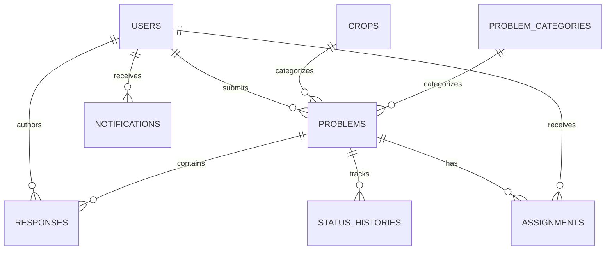

# Farm Problem Reporting & Expert Response System
## Database Specification

**Version:** 1.0  
**Database:** MongoDB  
**ODM:** Mongoose  
**Related documents:** `PRD.md`, `architecture.md`, `api.md`

## 1. Purpose

This document specifies the MongoDB collections, core fields, validation rules, indexes, and data-retention behavior. It is an implementation guide; adapt field types to the chosen Mongoose version while preserving the documented constraints.

## 2. General conventions

- Use MongoDB `ObjectId` references for relationships.
- Use Mongoose timestamps (`createdAt`, `updatedAt`) where appropriate.
- Store enums in one shared backend definition and mirror their labels in the frontend.
- Never store plaintext passwords; store only `passwordHash`.
- Keep reports and historical records when users/categories are deactivated.
- Validate authorization in services; Mongoose validation alone is not authorization.
- Avoid hard deletion of users or records that are referenced by historical cases.
- Use pagination for list endpoints.

## 3. Collections

### 3.1 `users`

Suggested fields:

| Field | Type | Rules |
|---|---|---|
| `fullName` | String | Required, trimmed, reasonable length |
| `email` | String | Optional if phone is used; normalized lowercase |
| `phone` | String | Optional if email is used; normalized |
| `passwordHash` | String | Required; never returned in API responses |
| `role` | String enum | `farmer`, `expert`, `admin` |
| `accountStatus` | String enum | `active`, `inactive`, `pending` |
| `preferredLanguage` | String | Optional, e.g. `en`, `mr`, `hi` |
| `location.village` | String | Optional |
| `location.district` | String | Optional |
| `location.state` | String | Optional |
| `expertise` | Array | Expert specializations; optional |
| `serviceDistricts` | Array | Expert service areas; optional |
| `tokenVersion` | Number | Optional session invalidation mechanism |
| `createdAt` / `updatedAt` | Date | Mongoose timestamps |

**Validation and indexes**
- At least one of email or phone must be present.
- Normalize email and phone before uniqueness checks.
- Ensure identifiers are unique using indexes. If identifiers are optional, use partial unique indexes rather than a naïve unique index on missing values.
- Use an index on `{ role: 1, accountStatus: 1 }`.
- Never allow public registration to set `role: admin` or `role: expert`.
- API serializers must exclude `passwordHash` and session secrets.

### 3.2 `crops`

| Field | Type | Rules |
|---|---|---|
| `name` | String | Required, trimmed |
| `normalizedName` | String | Required, normalized for duplicate detection |
| `localNames` | Map/Object | Optional localized display names |
| `description` | String | Optional |
| `isActive` | Boolean | Default `true` |
| `createdBy` | ObjectId ref `users` | Optional audit field |
| timestamps | Dates | Required by convention |

Create a unique index on `normalizedName`. Use soft deactivation (`isActive: false`) rather than deleting crops referenced by reports.

### 3.3 `problemCategories`

| Field | Type | Rules |
|---|---|---|
| `name` | String | Required |
| `normalizedName` | String | Required |
| `description` | String | Optional |
| `isActive` | Boolean | Default `true` |
| `createdBy` | ObjectId ref `users` | Optional |
| timestamps | Dates | Mongoose timestamps |

Create a unique index on `normalizedName`. Deactivate rather than delete categories referenced by existing reports.

### 3.4 `problems`

| Field | Type | Rules |
|---|---|---|
| `reportNumber` | String | Required, unique, generated server-side |
| `farmerId` | ObjectId ref `users` | Required, must refer to a farmer |
| `title` | String | Required, trimmed, bounded length |
| `cropId` | ObjectId ref `crops` | Required for the initial release |
| `categoryId` | ObjectId ref `problemCategories` | Required |
| `description` | String | Required, bounded length |
| `location.village` | String | Required or optional per final form policy |
| `location.district` | String | Required or optional per final form policy |
| `location.state` | String | Optional/default based on deployment |
| `location.latitude` / `longitude` | Number | Optional; validate geographic range if supported |
| `imageAttachments` | Array of objects | Storage key/URL, original safe display name, MIME type, size |
| `status` | String enum | Canonical status values below |
| `assignedExpertId` | ObjectId ref `users` | Nullable until assigned |
| `submittedAt` | Date | Server-generated |
| `resolvedAt` | Date | Set on resolution; clear or retain according to documented reopen policy |
| `lastActivityAt` | Date | Updated on response, follow-up, or status change |
| timestamps | Dates | Mongoose timestamps |

Canonical status values:

- `SUBMITTED`
- `ASSIGNED`
- `UNDER_REVIEW`
- `AWAITING_FARMER_INFORMATION`
- `RESPONSE_PROVIDED`
- `RESOLVED`
- `REOPENED`

Create indexes:
- Unique `{ reportNumber: 1 }`
- `{ farmerId: 1, submittedAt: -1 }`
- `{ assignedExpertId: 1, status: 1, updatedAt: -1 }`
- `{ status: 1, submittedAt: -1 }`
- `{ cropId: 1, categoryId: 1, status: 1 }`

Keep `assignedExpertId` as the current assignment shortcut for efficient queries, and use the separate `assignments` collection to preserve history.

### 3.5 `responses`

Store recommendations, information requests, and farmer follow-ups as append-only records.

| Field | Type | Rules |
|---|---|---|
| `problemId` | ObjectId ref `problems` | Required |
| `authorId` | ObjectId ref `users` | Required |
| `responseType` | String enum | `EXPERT_RECOMMENDATION`, `INFORMATION_REQUEST`, `FARMER_FOLLOW_UP`, `ADMIN_NOTE` |
| `message` | String | Required, trimmed, bounded length |
| `observations` | String | Optional |
| `recommendations` | Array/String | Optional; expert-authored |
| `requestedInformation` | String | Required for information requests |
| `attachments` | Array | Optional uploaded attachment references |
| `createdAt` | Date | Required |

Indexes:
- `{ problemId: 1, createdAt: 1 }`
- `{ authorId: 1, createdAt: -1 }`

Do not overwrite an earlier expert response to display a newer one. Add a new response record instead. Ensure the service verifies that the author is authorized for the report.

### 3.6 `statusHistories`

| Field | Type | Rules |
|---|---|---|
| `problemId` | ObjectId ref `problems` | Required |
| `previousStatus` | String enum/null | Null for initial creation if recorded |
| `newStatus` | String enum | Required |
| `changedBy` | ObjectId ref `users` | Required |
| `reason` | String | Optional |
| `createdAt` | Date | Required |

Index: `{ problemId: 1, createdAt: 1 }`.

Create a history entry for each successful status change. Prevent arbitrary client-supplied status changes by validating transitions in the service layer.

### 3.7 `assignments`

| Field | Type | Rules |
|---|---|---|
| `problemId` | ObjectId ref `problems` | Required |
| `expertId` | ObjectId ref `users` | Required active expert at assignment time |
| `assignedBy` | ObjectId ref `users` | Required admin |
| `assignmentStatus` | String enum | `ACTIVE`, `ENDED` |
| `assignedAt` | Date | Server-generated |
| `endedAt` | Date/null | Set when assignment ends |
| `reassignmentReason` | String | Optional |

Indexes:
- `{ problemId: 1, assignedAt: -1 }`
- `{ expertId: 1, assignmentStatus: 1, assignedAt: -1 }`

Only one assignment should be active for a problem. Enforce this with a partial unique index if supported by the selected MongoDB version, or enforce it transactionally in the assignment service. If reassigning, end the previous assignment and create a new one.

### 3.8 `notifications` (P1)

| Field | Type | Rules |
|---|---|---|
| `recipientId` | ObjectId ref `users` | Required |
| `problemId` | ObjectId ref `problems` | Optional for general notices |
| `type` | String enum | E.g. `REPORT_ASSIGNED`, `RESPONSE_ADDED`, `STATUS_CHANGED` |
| `message` | String | Required, short |
| `isRead` | Boolean | Default `false` |
| `createdAt` | Date | Required |

Indexes:
- `{ recipientId: 1, isRead: 1, createdAt: -1 }`

### 3.9 `auditLogs` (recommended for significant admin actions)

| Field | Type | Rules |
|---|---|---|
| `actorId` | ObjectId ref `users` | Required |
| `action` | String | Required, e.g. `USER_DEACTIVATED`, `REPORT_ASSIGNED` |
| `targetType` | String | Required |
| `targetId` | ObjectId/String | Required |
| `metadata` | Object | Avoid storing secrets or unnecessary personal data |
| `createdAt` | Date | Required |

Use audit logs for important administrative and security-relevant actions. Do not store passwords, tokens, or sensitive file contents.

## 4. Relationships

## 5. Consistency and transaction rules

Some operations modify more than one document. Use MongoDB transactions only when the deployment supports them; otherwise use carefully designed compensating logic and reconciliation.

- **Create report:** validate farmer/crop/category; generate report number; save report; record initial history if desired; clean up uploaded files if persistence fails.
- **Assign/reassign:** validate admin and active expert; end old assignment; create new assignment; update `assignedExpertId`; record audit/history as appropriate.
- **Change status:** validate the transition; update the problem; insert status history. Keep the operation atomic where possible.
- **Create response:** verify author/resource permissions; insert append-only response; update `lastActivityAt`; trigger notification creation if enabled.
- **Deactivate user:** change account status; preserve related reports, responses, and assignments.

## 6. Report number generation

Generate report numbers on the server. A format such as `FPR-2026-000123` is readable, but do not rely only on a count of documents because concurrent requests can collide. Use a dedicated counter with atomic increment, a UUID-based suffix, or another collision-resistant strategy. Enforce a unique index regardless.

## 7. Similar-case query

Retrieve candidates where:
- `status` is `RESOLVED`;
- `cropId` and `categoryId` match;
- at least one usable expert recommendation or resolution note exists;
- the candidate is not the current report.

Then compute a documented normalized keyword similarity score from title/description. Return only fields necessary for the expert comparison view and omit unnecessary farmer contact information.

## 8. Seed data and demo accounts

Provide a development-only seed script for:
- Common crop records.
- The problem categories listed in the PRD.
- One or more demo farmers, experts, and an admin.
- A small set of clearly labeled sample reports, including resolved cases for the similarity feature.

Rules:
- Demo credentials must be documented as local-only and changed/removed before public deployment.
- Never seed real personal information.
- Never expose an unauthenticated production endpoint that creates an admin.
- Keep seed data separate from production migrations.

## 9. Minimum viable implementation

For the initial working release, prioritize:
1. `users`
2. `crops`
3. `problemCategories`
4. `problems`
5. `responses`
6. `statusHistories`
7. `assignments`

Add `notifications` and `auditLogs` after the core workflow is reliable. Do not sacrifice authorization or status/assignment history to save time.

## 10. Database acceptance checklist

- [ ] Unique identifiers are enforced by indexes.
- [ ] Password hashes are excluded from API responses.
- [ ] Report ownership is verified in service logic.
- [ ] Expert assignments reference active expert accounts.
- [ ] Status changes create history records.
- [ ] Reassignments preserve previous assignments.
- [ ] Deactivated crops/categories do not break old reports.
- [ ] Resolved cases can be queried by crop/category.
- [ ] List endpoints use pagination and indexes.
- [ ] Seed scripts are safe and development-only.
